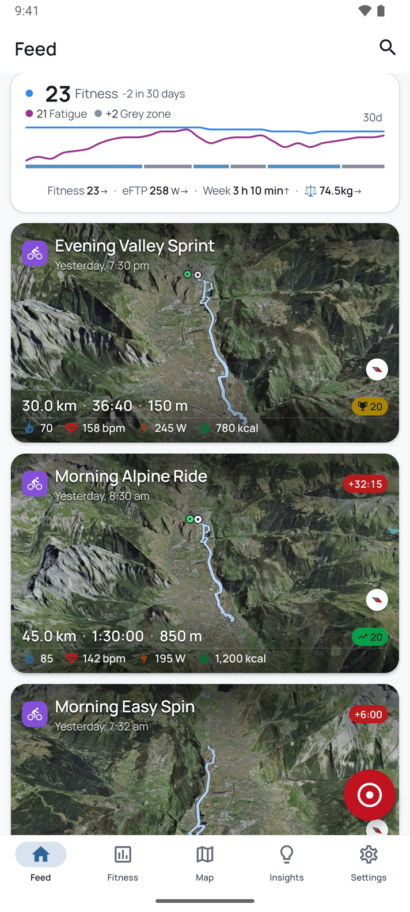
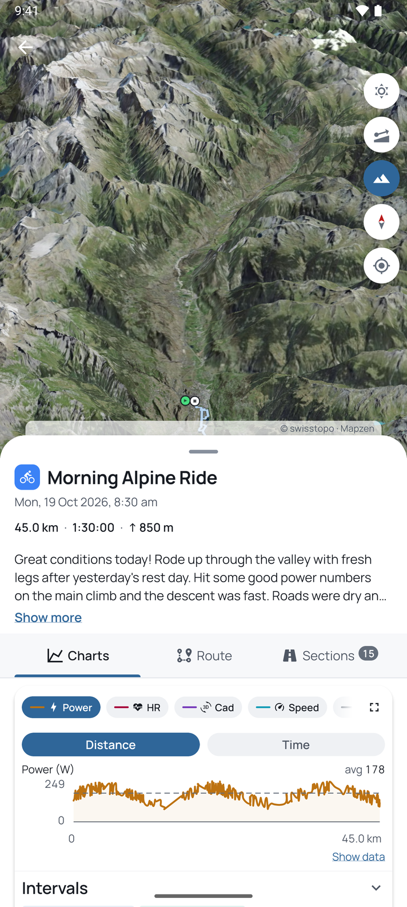
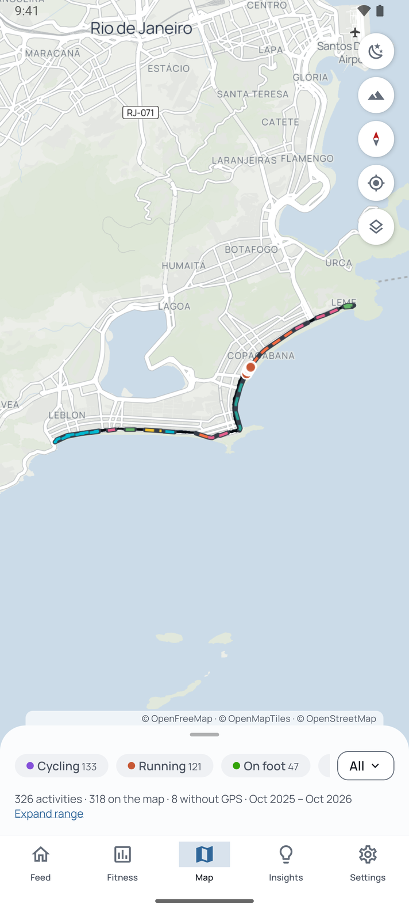
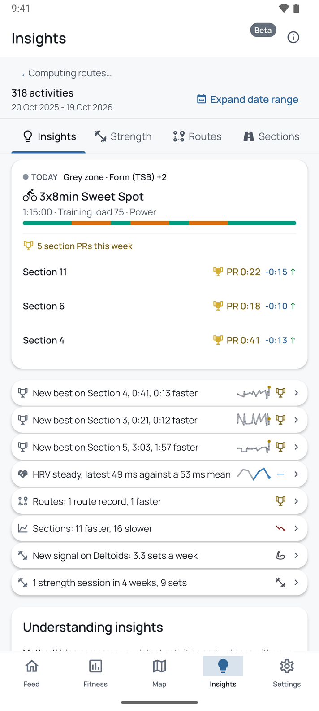

<p align="center">
  
</p>

<h1 align="center">Veloq</h1>

<p align="center">
  <strong>Open source mobile client for <a href="https://intervals.icu">intervals.icu</a></strong><br>
  Maps, charts, fitness and repeated routes, worked out on your phone.
</p>

<p align="center">
  <a href="https://apps.apple.com/us/app/veloq/id6757836732">
    
  </a>
  &nbsp;
  <a href="https://play.google.com/store/apps/details?id=com.veloq.app">
    
  </a>
</p>

<p align="center">
  <a href="https://veloq.fit">Website</a> •
  <a href="https://veloq.fit/privacy">Privacy</a> •
  <a href="https://github.com/evanjt/veloq/releases">Releases</a>
</p>

---

<!-- store-copy:readme-strip -->
<p align="center">
  
  
  
  
  
  
</p>
<!-- /store-copy:readme-strip -->

Veloq reads your training from intervals.icu and keeps a copy in a database on your phone. Maps,
charts, fitness, and the repeated routes and sections it finds are all worked out there, so the
app opens without a connection and no Veloq server holds your training data. The same data feeds
the insight cards, which show the method behind each one, the home screen widgets, the optional
push notifications for route and section personal bests, and the strength body diagram. Where
Veloq works something out itself, this README says how.

You need an intervals.icu account, or you can use the demo. It runs on iPhone and iPad (iOS 16.4
and up) and on Android (7.0 and up).

## Contents

Using it:

* [Install and sign in](#install-and-sign-in): OAuth, an API key, or the demo
* [Activity feed](#activity-feed): your activities, searchable, with a summary card
* [Activity detail and charts](#activity-detail-and-charts): streams, zones, intervals and stats
* [Maps](#maps): the map tab, 3D terrain, the heatmap and offline tiles
* [Routes and sections](#routes-and-sections): repeated journeys and stretches of road
* [Fitness](#fitness): CTL, ATL, form, power and pace curves, season bests
* [Health](#health): HRV, sleep, weight and summaries
* [Insights](#insights): cards for what changed, each with its method
* [Strength](#strength): a muscle diagram, exercise history and balance
* [Recording](#recording): GPS, indoor and manual rides, Bluetooth sensors, upload
* [Widgets and shortcuts](#widgets-and-shortcuts): home screen widgets and quick start
* [Notifications](#notifications): push for new activities and records
* [Backup and restore](#backup-and-restore): WebDAV, a folder, Google Drive or iCloud Drive
* [Export](#export): GPX and GeoJSON
* [Settings](#settings): display, maps, units, languages and storage

Knowing it:

* [How it behaves](#how-it-behaves)
* [Privacy and data](#privacy-and-data): what is stored and what leaves the phone
* [Limits](#limits)

Working on it:

* [Build from source](#build-from-source)
* [Tests](#tests)
* [How it fits together](#how-it-fits-together)
* [Contributing](#contributing)
* [License](#license)

## Install and sign in

Get it from the [App Store](https://apps.apple.com/us/app/veloq/id6757836732) or
[Google Play](https://play.google.com/store/apps/details?id=com.veloq.app). Veloq is free on both
stores and from GitHub Releases, and the three are the same app: nothing is gated on where it was
installed or on a purchase. The tips in the app are donations. There are three ways to sign in.

* OAuth: tap `Sign in with intervals.icu`, approve in the browser and you land back in the app.
  Veloq asks for read access to activities, wellness, the calendar and settings. The first time
  you record it asks again, for write access, so it can upload.
* API key: paste a key from your intervals.icu settings. It is checked before it is stored. If
  you are offline it is held and checked when the network returns.
* Demo: `Try Demo` loads sample data and needs no account. It lasts until you restart the app.

A card on the feed offers a short tour, which is also where notifications and backup are set up.

Credentials live in the platform keychain. If intervals.icu rejects your token, you are asked to
sign in again (an API key is kept so you can re-enter it). Signing in as a different athlete than
the library on the phone asks to wipe it first, and so does entering the demo.

`Sign out` keeps your library, so signing back in to the same account needs no re-download.
`Sign out and delete data` removes the library, local backup files and backup settings, WebDAV
details, sensors, names, section edits and the widget snapshot. Recordings stay on the phone, and
so do copies already in WebDAV, a folder, Google Drive or iCloud Drive. It also asks the server to
drop your push token. That can fail offline, and the token then expires within 30 days.

## Activity feed

The Feed tab lists your activities newest first, 30 days at a time. You can search the stored
library by name or sport, and filter with sport chips (cycling, running, swimming, other) and date
chips (last 90 days, this year, last year). They combine, and a count shows what matched. A date
chip also limits the search to that range.

At the top is the summary card. It shows one main metric, fitness, form or HRV, with an optional
30 day sparkline you can scrub. Under it sit up to four more: HRV, resting heart rate, weekly
hours, weekly count, FTP, threshold pace, CSS, fitness, form or weight. Each opens its chart. You
set it up under Settings, Summary card.

Each activity card has a map preview, distance, time and climb, a bar of time in zones, and load,
heart rate, power, calories and temperature when there are any. Activities with no GPS, like
indoor rides and pool swims, get a compact card with no map. If the activity is on a repeated
route or section, the card says so: a route record or the gap to your best, and counts of section
records and of sections you are improving or slipping on.

A pill marks an activity where half or more of its zoom 17 map tiles were touched by none of your
earlier activities. It reads `New ground` when every tile is new and `Mostly new ground`
otherwise. It measures tile coverage, not metres of new road.

Hold a card for details and share. Cards with a map also offer the map style (light, dark,
satellite) and the 3D toggle. Pull down to refresh, which also starts a sync.

## Activity detail and charts

An activity opens on a map header with its stats below and tabs for Charts, Routes and Sections,
plus Exercises for strength sessions. Routes and Sections appear for GPS activities when route
matching is on.

The chart can show power, heart rate, cadence, speed or pace, grade adjusted pace, elevation,
grade, W' balance and temperature. Each appears as a chip only if the activity has that stream.
Pick one, or overlay several, each scaled to its own range. Hold the chart for 200 ms and drag to
scrub, and a marker follows on the map. The axis switches between distance and time, and
fullscreen locks to landscape on a phone. Under the chart is the intervals.icu interval table,
collapsed by default. Expand it and the intervals are shaded on the chart. Time in heart rate and
power zones follows, with the source of the max heart rate used.

The stats cards cover training load, fitness impact (what the activity did to CTL, ATL and form),
speed or pace, heart rate (with recovery, resting heart rate and HRV that day), cadence, energy,
conditions (temperature, feels like, wind) and power (average, max, percent of FTP, efficiency
factor, decoupling). A card only appears when its data exists, and each opens a detail sheet. A
button exports the track as GPX.

Streams are fetched in the background after the track. If there are many to fetch (over 500) a
card in the feed asks first and says how large they are.

## Maps

The Map tab shows every activity with a GPS track as a dot in the sport's colour, clustered and
fading with age over a year. You can filter by period, distance band, sport and name, and a layers
menu turns activities, sections, the heatmap and routes on and off. There are controls for 3D, the
compass, your location and the style.

The heatmap is drawn on the phone from your stored GPS tracks, at zoom 1 to 17. Turning it off
under Settings, Maps deletes the tiles. On an activity's own map the track is drawn in the sport
colour, or optionally coloured by grade (blues for descents and oranges for climbs, from -30 to
+30 percent), and it can go fullscreen.

3D terrain adds hillshade and sky. Under Settings, Maps you pick `Off`, `Smart` or `Always`, as a
default and per sport group. `Smart` draws 3D when the route has 30 m or more between its lowest
and highest point. When you leave 3D on an activity, the camera angle you left it at is saved for
that activity and keeps 3D on in `Smart` mode.

Styles are light and dark vector maps, and satellite. Satellite uses national imagery inside
Switzerland, metropolitan France, the continental USA, mainland Spain and the Balearics, Austria,
the Netherlands, Czechia, Poland and Luxembourg, once zoomed in past each source's minimum.
Sentinel-2 cloudless covers everywhere else and the zoomed out view.

Tiles go through an on-device cache (50, 100, 200 or 400 MB, default 50). After a sync it keeps
low zoom ground around your activities and terrain around the areas you ride most. Satellite
imagery is never kept, so offline it falls back to the vector map.

## Routes and sections

Both are found on the phone by [tracematch](https://github.com/evanjt/tracematch), over your
stored GPS tracks. You can turn it all off under Settings, Routes and sections, and your stored
sections and edits are kept. Routes and Sections are tabs on the Insights screen, beside Insights
and Strength, and they appear when route matching is on.

A route is the same journey done again: two or more activities of similar length that start and
finish in the same places and follow the same path. Loops match even when you start at a
different point on them, and a route ridden the other way is marked as reversed. Sport is not
checked, so a run and a ride over the same course share a route.

A section is a stretch of road that turns up in many of your activities, even when the journeys
around it differ. It needs visits on separate days over at least a week, and short sections need
more visits than long ones. The line drawn is always one of your real tracks, never an average.
Chairlifts and gondolas are left out, and roads shared by runners and riders form one section.

The exact rules and their defaults are in the
[tracematch README](https://github.com/evanjt/tracematch#section-detection).

The Routes list has search, a sport filter and sorting by nearby, activities, distance or name.
An empty list says why: no GPS, waiting, analysing or nothing found. The Sections list sorts by
nearby, relevance, visits, distance or name, and you swipe a row to remove or restore it. `Accept
all` pins every auto section so re-detection keeps it.

A route page has the attempts chart, first and last visit, best and average, a yearly calendar,
and controls to rename it, set the reference activity, exclude an attempt and export GPX. Times
are moving time, and your standing reads like "Ranked 3 of 12, 40 s off your best".

A section page has scatter, histogram and delta charts over 1 month to all time, a personal best
for each direction, laps and the wellness correlations. Times there are
elapsed time, and a best only counts as a record once every time stream is in. A correlation
shows only when the link is unlikely to be chance, with at least 10 attempts to go on.

You can trim or extend a section by dragging its ends, merge similar sections nearby, rename it,
remove it, delete your own, re-match activities, or draw a custom section on an activity. Every
change is kept in the section's history (formed, split, re-cut, merged, trimmed, renamed), so you
can preview an earlier shape and revert to it. Sections the detector dropped are listed under
`Retired sections` with the one that replaced them. New routes and sections are numbered, and a
name you give is kept across re-detection.

Settings, Routes and sections has two preview tools. For sections you pick an area, move the
sliders for length, visits and how close tracks must be, then see new, changed and removed
sections side by side. Nothing changes until you keep it. For routes you set how closely tracks
must match and how far apart their ends may be. `Reanalyse sections` rebuilds the
unaccepted ones.

Detection waits for the elevation download, runs in the background and shows its progress on the
Insights tabs. A rebuild or a long download pauses it, and the screen says why.

## Fitness

Pick cycling, running or swimming. Until you choose, the tab follows the sport that makes up most
of your library (cycling if none stands out).

CTL and ATL come from intervals.icu. Form is worked out in the app as rounded CTL minus rounded
ATL, and shown in zones: below -30 high risk, -30 to -10 optimal, -10 to 5 grey zone, 5 to 25
fresh, above 25 transition. The ranges run from 7 days to 1 year and all read from the stored 365
days. If you use form as a percent in intervals.icu, Veloq follows that. A strip under the chart
shows daily load, and a day opens its activities. eFTP changes are marked.

For cycling there is a power curve of best power by duration, in watts or watts per kilogram, with
an FTP line and the fitted models (2P, 3P, FFT, ECP) giving critical power and W'. The fits come
from intervals.icu and are not computed on the phone. Running and swimming have pace curves, with
grade adjusted pace, critical speed and D' for running, and critical swim speed per 100 m or 100
yd for swimming.

Season bests list cycling from 5 s to 60 min, running from 400 m to the half marathon and swimming
from 100 m to 1500 m, plus climbing bests for cycling and running. The `Best efforts` screen shows
all three sports and adds an all time period. The tab also has training zones, an eFTP trend
(intervals.icu's own estimate), a running threshold card, and aerobic decoupling taken from
intervals.icu's stored value for your newest ride with power, heart rate and 30 minutes or more.

## Health

The Health tab has one sparkline row each for HRV, resting heart rate, sleep, sleep score and
weight, when you have them. Scrub a row to read a day. Smoothing is a moving average (auto, none,
or 3, 7, 14, 21 or 28 days), and the readout shows that day's own reading.

Below that is a 52 week activity calendar, where scrubbing highlights the day on the wellness
chart, then a summary of this week, month, 3 months, 6 months or year against the one before, and
a season comparison of this year against last by month, in hours, distance or load.

## Insights

The Insights tab shows up to 8 cards, ranked, with at most 2 per category (3 for section records).
Tap one for its figure, its history and the method behind it. A banner above them shows your form
and today's or tomorrow's planned workout from your intervals.icu calendar.

The cards are all rule based:

* Section record: a best time with 3 or more outings, set within 14 days. A first outing is never
  a record. Section trend is the matching card.
* Route records and trends.
* Stale record: your fitness is up at least 3 percent since a record was set and you have not
  been back for 30 days, so it may be beatable.
* Fitness milestone: eFTP or pace moved (5 W up or 10 W down, or 1 percent faster or 2 percent
  slower).
* Period comparison: this week's load (hours when there is no load) against last week's. It only
  shows past a 15 percent change.
* HRV trend: at least 5 valid days in 7. A change counts only if it is clearly more than day to
  day noise and is over half a standard deviation and 2 percent of the earlier mean.
* Efficiency trend, experimental and shown only in `Debug mode`: heart rate against pace on a
  repeated section, by regression over at least 3 efforts for an improvement and 5 for a decline.
  The section page shows the same trend then.
* Section changed, when detection re-cuts, splits or merges a section.
* Strength progression and balance, below.

## Strength

A Strength tab appears once you have strength activities. The sets are read from each activity's
FIT file and parsed on the phone.

A front and back body diagram shades 15 muscle groups by weighted sets (1.0 for a primary muscle,
0.5 for a secondary one), over periods from 7 days to 6 months. Tap a muscle for its sets, reps,
volume and four week progression. Tap an exercise for its history, the best set per session and
an estimated one rep max (for sets of 1 to 10 reps).

Balance compares quadriceps and hamstrings, chest and upper back, and biceps and triceps. A ratio
of 1.35 or more is a watch, 2.0 or more is imbalanced, and under 4 weighted sets says there is not
enough to tell.

## Recording

Record from the button on the feed. The modes are GPS (31 sports), indoor (8) and manual entry
(13). GPS has three presets: high (1 s or 5 m), balanced (2 s or 10 m) and battery saver (5 s or
20 m). Fixes worse than your accuracy limit are dropped, and auto pause is on by default.

Bluetooth heart rate, power, and speed and cadence sensors pair under Settings, Sensors and
reconnect at the start of a ride. Recording carries on in the background, with a notification on
Android and a Live Activity on iOS. The ride is backed up every 15 s, so after a crash the app
offers to resume it.

When you finish you can trim it, edit it, add notes and an effort score (1 to 10). A FIT file is
made on the phone and kept under `My Recordings`.

Upload goes to intervals.icu and works offline: it queues and retries on its own. Auto upload is
on by default, and a ride is never posted twice. When the synced copy arrives from intervals.icu
it replaces the provisional entry in your library. An API key can upload straight away. With
OAuth you are asked for upload access the first time, and if you decline the ride stays on the
device. Demo mode never sends anything.

## Widgets and shortcuts

There are four widgets on each platform: Summary (your summary card, with the metrics chosen when
you place it on Android), Latest activity (the most recent one, its route comparison, records and
load), Insights (the top cards, with a choice of kinds) and Strength (the body diagram for the
trailing 30 days).

Android also has a Quick Settings tile that starts a recording. iOS has a Control Centre control,
Siri, Spotlight and Shortcuts actions, and a Live Activity and Dynamic Island while recording.
Android refreshes widgets after a sync, every 6 hours in the background while it has network and
battery, and redraws the age line every 15 minutes. iOS reloads after a sync and otherwise about
every 4 hours.

## Notifications

Notifications are off until you turn them on, and need an OAuth sign in. Veloq shows a privacy
notice first, then asks for the OS permission. When intervals.icu reports an upload, analysis,
achievement, fitness, wellness or settings change, the server sends a push with no personal text
(data only on Android, and a generic placeholder on iOS that the phone rewrites). The phone builds
the final text itself: a route or section record, a faster than usual ride, a fitness milestone.
Settings has switches for personal bests and fitness milestones.

The route and section messages are worked out on the phone from your own routes and sections.
Three examples, with invented place names:

* New PR: "Route PR on Hill Repeat (12 s faster)"
* New PR: "PR on Riverside Climb (1:05 faster)"
* Faster than usual: "Faster than usual on Lakeside Loop (34 s off PR)"

## Backup and restore

Under Settings, Automatic backup. A backup is a zip of your settings, names, pins, cuts,
exclusions and section history. Activities are not in it, they sync again after a restore.

**Backups are not encrypted.**

It can go to WebDAV (URL, user and password, `https` unless you opt in for a local network
address, with a Nextcloud QR option), a folder you choose, Google Drive on Android (the hidden app
data folder) or iCloud Drive on iPhone (a Veloq folder the Files app shows, on unless you turn it
off). On Android it goes to `Documents/Veloq` until you pick another folder, and that copy stays
after the app is uninstalled. On iPhone the device backup also carries the latest zip. Android's
device backup does not include Veloq.

Automatic backup is off by default. When on, it runs at most once every 24 hours, after a sync or
when the app goes to the background, and a copy a destination could not take is sent again when
the network returns. `Back Up Now` runs it on demand. To restore, pick a dated backup from any
destination, from the login screen or from Settings. A backup from another account is refused.
`Export Backup` shares the zip and `Import Backup` replaces settings and names from one.

## Export

A single activity, route or section exports as GPX from its page. You can also export every
activity at once, as a zip of GPX files (with `activities.json`, `skipped.json` and
`export.json`) or as one GeoJSON file. Track points carry elevation when there is any, with the
start time in the metadata and no time per point. Activities with no GPS, or trimmed or unreadable
ones, are skipped and counted.

`Leave home out` trims the start and end of each exported track within 100, 250 or 500 m of a home
you set. It only changes the exported copy. A recording can be shared as its FIT file. There is no
import of GPX or FIT files from outside, apart from restoring a Veloq backup.

## Settings

The Settings screen has Account, Display, Maps, Summary card, Local data range, Recording,
Sensors, Routes and sections, Backup, Cache & Database, Notifications, Support, Data Sources and
About.

Theme is system, light or dark. Units are auto (from your intervals.icu setting, or the region),
metric or imperial. Languages are Danish, German (Germany and Switzerland), English (UK, US,
Australia), Spanish (Spain and Latin America), French, Italian, Japanese, Dutch, Polish,
Portuguese (Brazil and Portugal) and Simplified Chinese. Android also follows the system per app language.

Local data range sets how far back to sync. The default is 90 days and it only widens. Going back
500 or more activities asks first. You can stop a running sync there. Storage shows what the
database, tracks and map cache take, with a clear cache button and how long to keep streams (30
days to forever).

For accessibility there are screen reader labels throughout, text scaling, reduce motion,
readable contrast in both themes and large tap targets. Text follows the system size, except that
dense surfaces (number grids, chart labels, the tab bar) stop growing at 130 per cent, and past it
the grids drop columns instead, down to one. It has had no full accessibility audit.

For debugging, tap the version five times, quickly, and switch on `Debug mode`. A developer
dashboard appears with library stats, sync timeline, map tiles and memory.

## How it behaves

Your data stays on the phone, and it all works offline because everything is read from the local
database. Veloq does not coach, predict or encourage. It shows numbers from your data and how
they were worked out, and insight cards open the figures behind them.

Your edits are kept. Names, pins and trims survive re-detection, and previews, retuning and
upgrades do not change your sections, activities or names until you accept them. Long work like
detection runs in the background, shows its progress and picks up where it left off.

## Privacy and data

Your training data lives in a database on the phone. No Veloq server holds it, and there is no
analytics or crash reporting library in the app. This is everything that leaves the phone:

| To | What | When |
|----|------|------|
| intervals.icu | Your credential and the requests that read your data (and writes for uploads) | Signed in |
| `auth.veloq.fit` | The OAuth state and code exchange, and your push token with athlete id. To register or remove a push token it also gets your access token, which it passes to intervals.icu to check the athlete and does not keep | Sign in, and notifications on |
| Expo push service, then Apple or Google | Your device's push token, from the phone. From the server: event type, athlete id and activity id | Notifications on |
| Map tile hosts | Tile coordinates (and your IP). The ground pre-fetch after a sync is derived from your activity bounds | Using maps |
| WebDAV, Google Drive (Android), iCloud Drive (iPhone) | Your backup zip | Automatic backup on. WebDAV and Google Drive need setting up, iCloud Drive is on unless you turn it off |
| Apple or Google billing | A tip purchase | If you tip |

The server on `auth.veloq.fit` keeps sign-in state for a few minutes and your push tokens for 30
days (up to 10 per athlete). It never stores your access token.

The policy is at [veloq.fit/privacy](https://veloq.fit/privacy).

If something goes wrong with the database: one written by a newer version of the app is refused
and left alone, and a corrupt one is set aside and a fresh one opened, keeping your recordings,
names and sections.

## Limits

* Routes and sections need GPS, so trainer, pool and strength sessions have none.
* Sections need visits on separate days over at least a week, the default window is 90 days, and
  sections under 150 m are not found.
* A route's start and end must agree within 250 m by default, so a few rides that start elsewhere
  will not group.
* GPS tracks among tall buildings or with big jumps can match loosely or not at all.
* The app asks at 500 or more activities and warns it is not guaranteed to stay quick.
* Records on sections need the time streams, which download after the tracks.
* There is no periodic background sync of activities. Data comes on launch, foreground, pull to
  refresh and push. A placed widget also refreshes the last two weeks of wellness in the
  background.
* There is no GPX or FIT import, no offline region download, no custom date range on the feed, and
  no planned workouts beyond today and tomorrow.
* Wellness fields such as mood, soreness and stress are stored but only used in the section
  correlations.

## Build from source

You need Node (the version in `.nvmrc`), Rust (from `rust-toolchain.toml`, rustup picks it up),
Java 17 and the Android SDK for Android, and a Mac with Xcode for iOS.

`android/` and `ios/` are generated from the Expo config and are not tracked, so generate them
first:

```bash
git clone --recurse-submodules https://github.com/evanjt/veloq
cd veloq
npm install
CI=1 npx expo prebuild --platform android --no-install
npx expo prebuild --platform ios --no-install   # macOS only
```

Rust needs the targets for the platform you build:

```bash
# Android
cargo install cargo-ndk
rustup target add aarch64-linux-android x86_64-linux-android   # and set JAVA_HOME

# iOS
rustup target add aarch64-apple-ios aarch64-apple-ios-sim
```

Then:

```bash
npm start                  # Metro dev server
npm run android            # run on a connected device or emulator
npm run android:debug      # debug APK with the JavaScript bundled in
npm run ios                # run on a simulator
npm run bundle:android     # rebuild the Android JavaScript bundle
```

`npm run android` and `npm run android:debug` compile the engine with the `release-dev` Rust
profile, which has no fat LTO and 16 codegen units rather than one, so an engine edit does not
recompile the crate as a single unit. An engine timing taken on such a build is not the shipped
engine's: take it on `npm run android:standalone`, which compiles `release`. Export
`VELOQRS_RUST_PROFILE=release` to build a debug APK with the shipped profile, and export it again
for `npm run install:android`.

## Tests

```bash
npm test                   # Jest, the app
npm run test:tooling       # Jest, build scripts and hooks
npm run test:rust          # Rust, the veloqrs engine
npm run maestro:smoke      # end to end smoke flows (needs Maestro and a device or emulator)
npm run maestro:full       # all end to end flows
```

**The Maestro flows reset the app's data.** Do not run them on a phone you use. The tests, lint
and builds also run on GitHub Actions for every pull request.

## How it fits together

`modules/veloqrs` is the Rust engine. It owns storage, the intervals.icu and map tile
requests, and anything computed, and TypeScript reaches it through UniFFI. Sign-in, push
registration and backups talk to their servers from TypeScript. Route and section detection is the
`tracematch` crate, a git submodule at `modules/veloqrs/rust/tracematch`.

`src` is the app, Expo and React Native in TypeScript with `expo-router`, and Skia and d3-shape
for charts. `widget` holds the Android and iOS widgets and `push/ios` the iOS notification
extension. `oauth-proxy` is the Cloudflare Worker behind `auth.veloq.fit` (OAuth, push tokens, the
intervals.icu webhook relay). `.maestro` has the end to end flows and `scripts` the build, guard
and device helpers.

### Adding a data source

The engine asks its data source through two traits in
`modules/veloqrs/rust/veloqrs/src/net/source.rs`: `Source` for every read a sync, a backfill or a
fetch makes, and `SourceWrites` for what an upload sends. intervals.icu implements both in
`net/intervals/`. To read from another service:

* Implement `Source` and `SourceWrites` for a type in `net/<name>/`, building its requests on the
  shared `Transport` (`net/transport.rs`) so they go through the same pacing and retry.
* Point `LiveSource`, `LIVE_BASE_URL` and `live_source` in `net/live.rs` at the new type. Every
  caller holds a `LiveSource`, so nothing else changes.
* Answer in intervals.icu's shapes: the raw bodies the engine stores, sport type strings,
  `start_date_local` and stream names. The engine parses and stores those forms, so map the new
  service's answers into them as they arrive.

Some things are intervals.icu's and sit outside the seam: OAuth sign-in and its client id
(`src/features/auth/constants.ts`), the `oauth-proxy` worker with its push token store and
webhook relay, and the web links in `src/shared/app/constants.ts`.

## Contributing

Open an issue or a PR on [GitHub](https://github.com/evanjt/veloq). Before committing, run what
the hooks run (`npm run prepare` installs them):

```bash
npm run audit
npx tsc --noEmit
npm run lint               # no warnings allowed
npm test
```

A schema change needs a migration.

## License

[Apache 2.0](LICENSE). Third party notices are in `NOTICE` and `THIRD_PARTY_LICENSES.md`.
