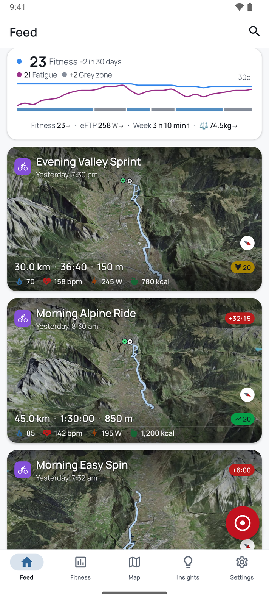
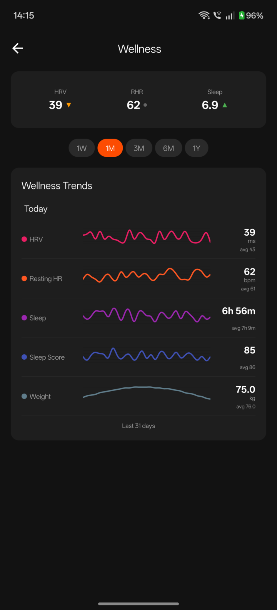
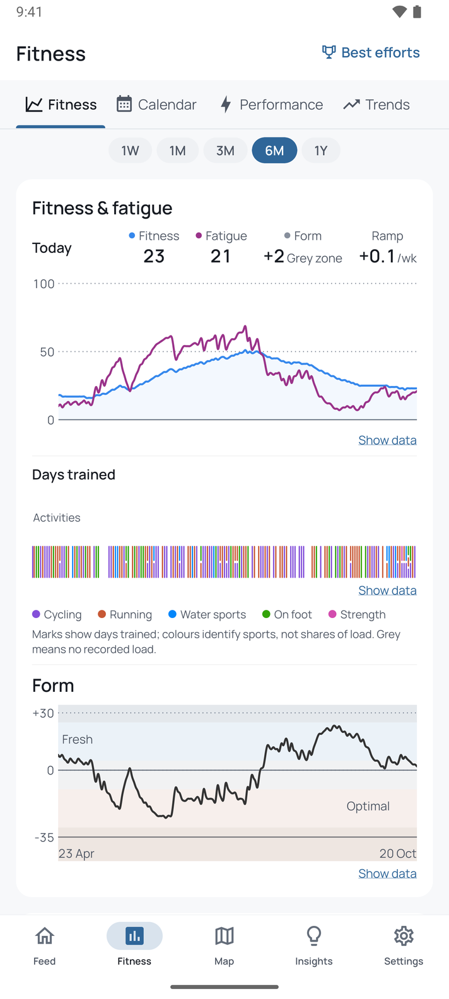
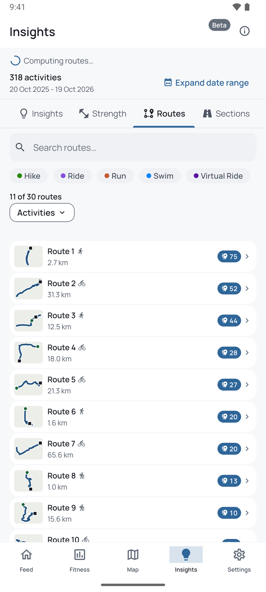

<p align="center">
  
</p>

<h1 align="center">Veloq</h1>

<p align="center">
  <strong>Open-source mobile client for <a href="https://intervals.icu">intervals.icu</a></strong><br>
  Maps, charts, and fitness tracking, open source, your data stays yours.
</p>

<p align="center">
  <a href="https://apps.apple.com/us/app/veloq/id6757836732">
    
  </a>
  &nbsp;
  <a href="https://play.google.com/store/apps/details?id=com.veloq.app">
    
  </a>
</p>

<p align="center">
  <a href="https://veloq.fit">Website</a> •
  <a href="https://veloq.fit/privacy">Privacy</a> •
  <a href="https://github.com/evanjt/veloq/releases">Releases</a>
</p>

---

<p align="center">
  
  
  
  
  
</p>

## Features

- **Maps**. Interactive GPS visualization with 3D terrain and heatmaps
- **Charts**. Heart rate, power, pace, elevation with synchronized map scrubbing
- **Route Matching**. Automatic detection of repeated routes for progress tracking
- **Fitness**. CTL/ATL/TSB model with form zone visualization

See [veloq.fit](https://veloq.fit) for the full feature list.

## Getting Started

1. Install from the [App Store](https://apps.apple.com/us/app/veloq/id6757836732) or [Google Play](https://play.google.com/store/apps/details?id=com.veloq.app)
2. Sign in with **OAuth** or use an **API key** from [intervals.icu Settings](https://intervals.icu/settings)

## Alternative Installation

### Android (Obtainium / Sideloading)

APK files are published to [GitHub Releases](https://github.com/evanjt/veloq/releases) with each version. Use [Obtainium](https://github.com/ImranR98/Obtainium) with this repo URL for automatic updates.

Note: GitHub APK uses a different signing key than Play Store. Switching requires a reinstall.

### Build from Source

See [Development](#development) below.

## Development

```bash
npm install

npm run android             # Veloq Dev, debug build, then start Metro
npm run android:standalone  # Veloq Dev, release build with its JavaScript, no Metro
npm run android:prod        # Veloq, release build
npm run ios                 # Veloq Dev, Debug, served by Metro
npm run ios:standalone      # Veloq Dev, Release
npm run ios:prod            # Veloq, Release
```

Each command names its identity, so `APP_VARIANT` in the shell changes none of them.
Both Dev builds sign with the debug key and replace each other in place, keeping the
app's data.

Set `ANDROID_SERIAL` when more than one Android device is attached. The Android commands
build first, then install and launch on that device. For a build without an install,
use `npm run android:debug`; install that verified APK later with
`npm run install:android debug`, or a release APK with
`npm run install:android -- release --identity dev` (or `production`). Regenerate
bindings after changing a Rust export with `npm run ffi:generate`.

Native Rust builds use Cargo's `release` profile by default. For local Dev
iteration, set `VELOQRS_RUST_PROFILE=release-dev` before the build. Android's
`-PveloqrsRustProfile=release-dev` property takes precedence over the variable;
Xcode can read it from `.xcode.env.local`. The choice also applies when checking
an APK with `scripts/install-apk.sh`, so keep the variable set through install.
Production builds use `release`.

`release-dev` keeps release optimization but disables LTO and uses 16 codegen
units. In the measured Android edit cycle, the Rust link fell from about 120 s
to 23 to 24 s. It is for local testing only: the different codegen layout can
change route matching timing, so use a release build for performance decisions.
On the host synthetic route matching benchmark, the measured median was
88.795 µs for release and 74.452 µs for release-dev.

### E2E Tests (Maestro)

Install [Maestro](https://maestro.mobile.dev/getting-started/installing-maestro), then with an emulator/simulator running:

```bash
npm run maestro:smoke       # Quick launch check (tier0)
npm run maestro:gate        # Smoke + critical path (tier0+tier1)
npm run maestro:test        # Full feature coverage (tier0+tier1+tier2)
npm run maestro:full        # Everything including stress tests (tier0-tier3)
```

Run a single flow:

With both handsets attached, export `ANDROID_SERIAL` first; Maestro takes no lock and picks its own transport, so every run goes through the wrapper:

```bash
export ANDROID_SERIAL=<serial>
scripts/with-maestro.sh test .maestro/recording-start-stop.yaml
```

### E2E in CI

The same flows run on GitHub Actions. Trigger a run from the Actions tab or the CLI:

```bash
gh workflow run e2e.yml                      # full suite (tier0-3), Android + iOS
gh workflow run e2e.yml -f tier=tier0,tier1  # quick core run only
```

These also run on their own: a smoke check and tier0+1 after every push to main, and the full Android suite weekly (Sundays). None of them block a merge. A red run is a signal to look, not a gate.

**Stack:** React Native + Expo, TanStack Query, Zustand, Victory Native, MapLibre, Rust (route matching)

## Debugging

### Enabling Debug Mode

1. Open **Settings**
2. Tap the **version number** 5 times quickly
3. A **Debug Mode** toggle appears, switch it on
4. A **Developer Dashboard** link appears below the toggle

### Debug Features

**Developer Dashboard** (Settings > Developer Dashboard)

- Engine stats: activity count, GPS tracks, route groups, sections, cache sizes
- FFI performance: per-method call count, average/max/p95 timing, color-coded thresholds
- Memory: JS heap size, allocated bytes, garbage collection count
- Share debug snapshot as JSON

**Activity Detail** (long-press activity name when debug enabled)

- Clone activity for stress testing (10/50/100 copies)
- Debug info panel: activity ID, GPS point count, HR samples, per-page FFI metrics
- Warnings for large polylines (>2000 points) or slow FFI calls (>200ms)

**Section Detail / Route Detail**

- Debug info panel with section/route metadata and FFI call metrics

**Routes Screen > Debug Tab**

- API vs Engine alignment with traffic light indicator
- Engine stats (mirrors Developer Dashboard)
- Sync status: progress, last sync timestamp, date range
- Actions: Force Sync, Remove N Activities & re-sync, Hard Re-sync

**Console Logging** (requires dev build)

```bash
adb logcat | grep -E '🔴|🟡|🟢|\[NAV\]|━━━'
```

- Screen render timing (green <200ms, yellow <500ms, red >500ms)
- FFI call timing (green <50ms, yellow <100ms, red >100ms)
- Navigation markers between screens
- Memory pressure stats with `[MEM]` prefix

## Privacy

Veloq doesn't store your data, but we have no control over data stored on intervals.icu. All analytics and activity data is sourced from there. OAuth uses a lightweight proxy for token exchange; API key mode is fully serverless.

Routes and sections are generated on-device using [tracematch](https://github.com/evanjt/tracematch).

- [Privacy Policy](https://veloq.fit/privacy)
- [intervals.icu Terms](https://forum.intervals.icu/tos)

## License

[Apache 2.0](LICENSE)
